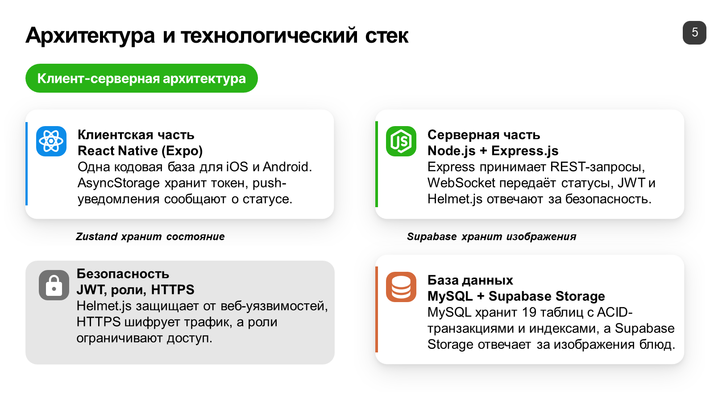
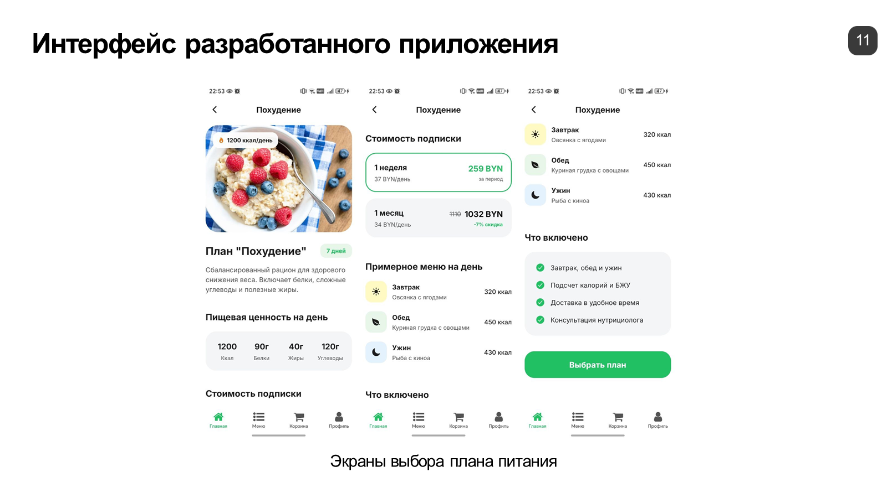
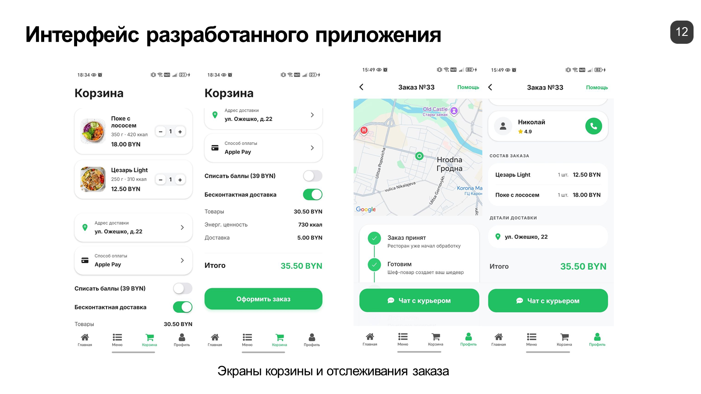
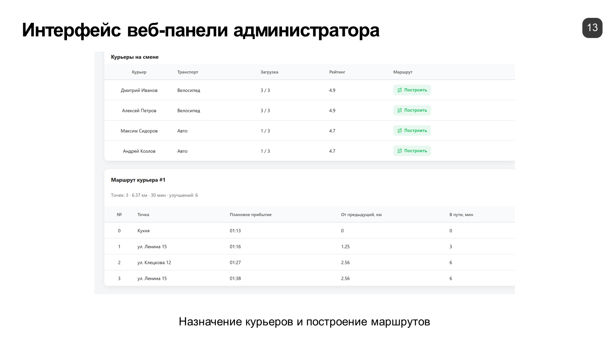
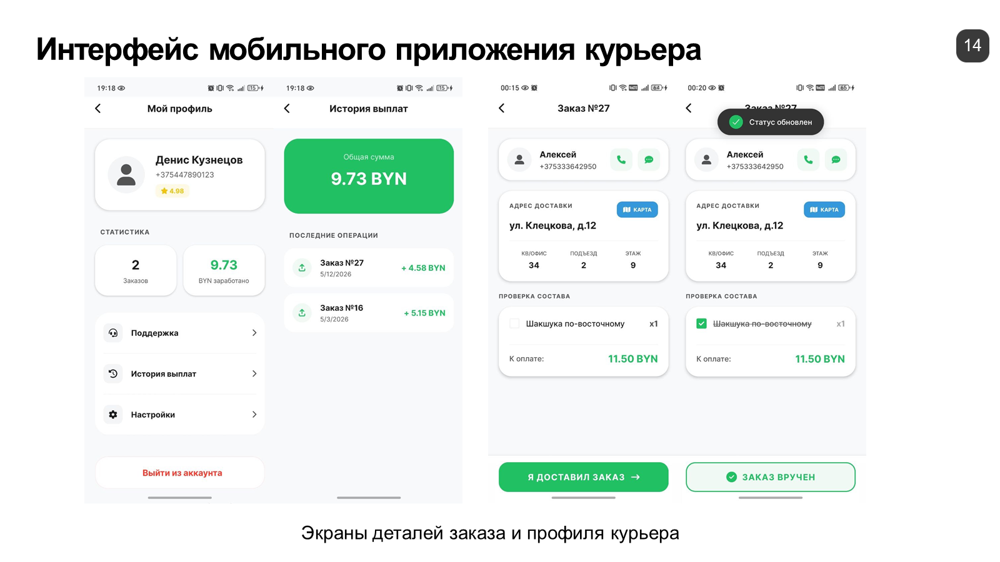

# Автоматизация и оптимизация процессов логистики в сервисах доставки еды

**Автор:** Михайлов Богдан Анатольевич  
**Группа:** СДП-УИР-232  
**Специальность:** 6-05-0414-04 «Управление информационными ресурсами»  
**Учреждение:** Гродненский государственный университет имени Янки Купалы, факультет математики и информатики, кафедра системного программирования и компьютерной безопасности

## О проекте

Учебный проект представляет собой сервис доставки еды с тремя интерфейсами:

- мобильное приложение клиента;
- мобильное приложение курьера;
- веб-панель администратора.

Серверная часть автоматизирует приём заказов, назначение курьеров и построение маршрутов. В основе логистики лежат матрица стоимости назначения, венгерский алгоритм, модель CVRPTW с временными окнами и локальные операторы улучшения маршрута.

## Возможности

- каталог блюд, планов питания и подписок;
- корзина, оформление заказа и отслеживание статуса;
- приложение курьера со списком заказов, деталями доставки и сменой статусов;
- админ-панель с заказами, курьерами, маршрутами и аналитикой;
- автоматическое назначение курьеров с учётом загрузки, расстояния и риска опоздания;
- построение маршрута с учётом временных окон и доставки нескольких заказов за смену;
- REST API, JWT-авторизация и обмен событиями через WebSocket.

## Стек

| Слой | Технологии |
|---|---|
| Клиент | React Native, Expo, TypeScript, Zustand, AsyncStorage |
| Курьер | React Native, Expo, TypeScript, Zustand, AsyncStorage |
| Админ-панель | React, TypeScript, Vite |
| Сервер | Node.js, Express.js, REST API, WebSocket, JWT |
| База данных | MySQL 8.0, InnoDB, ACID, индексы |
| Хранение изображений | Supabase Storage |
| Инфраструктура | Docker, Docker Compose, nginx |
| Тесты | Node.js test runner |

## Структура проекта

```text
.
├── admin-panel/          # веб-панель администратора
├── backend/              # REST API, WebSocket и алгоритмы логистики
│   ├── config/           # подключение к БД и настройки логистики
│   ├── controllers/      # обработчики API
│   ├── middleware/       # JWT-авторизация
│   ├── routes/           # маршруты Express
│   ├── services/         # назначение курьеров и маршрутизация
│   ├── sql/              # schema.sql и seed.sql
│   └── test/             # тесты алгоритмов
├── mobile-client/        # приложение клиента
├── mobile-courier/       # приложение курьера
├── docs/screenshots/     # скриншоты интерфейсов
├── docker-compose.yaml
└── .env.example
```

## Требования

- Node.js 20 или новее;
- npm 10 или новее;
- MySQL 8.0 **или** Docker Desktop;
- Expo Go, Android Studio или Xcode — для запуска мобильных приложений на устройстве/эмуляторе;
- Git.

## Быстрый старт через Docker Compose

1. Скопируйте примеры окружения:

```bash
cp .env.example .env
cp backend/.env.example backend/.env
cp admin-panel/.env.example admin-panel/.env
cp mobile-client/.env.example mobile-client/.env
cp mobile-courier/.env.example mobile-courier/.env
```

Для Windows PowerShell:

```powershell
Copy-Item .env.example .env
Copy-Item backend/.env.example backend/.env
Copy-Item admin-panel/.env.example admin-panel/.env
Copy-Item mobile-client/.env.example mobile-client/.env
Copy-Item mobile-courier/.env.example mobile-courier/.env
```

2. Заполните `.env` и `backend/.env`:

- `DB_NAME` и `DB_PASSWORD` должны совпадать в обоих файлах;
- в `backend/.env` укажите `DB_HOST=db`, `DB_PORT=3306`, `DB_USER=root`;
- задайте свой `JWT_SECRET`;
- при необходимости заполните параметры кухни и логистики;
- в `admin-panel/.env` и `mobile-client/.env` заполните `*_SUPABASE_URL` и `*_SUPABASE_ANON_KEY` (ключи проекта Supabase).

Для Docker-сборки веб-версий в `admin-panel/.env` и `mobile-client/.env` укажите `VITE_API_URL=http://localhost:3000/api` и `EXPO_PUBLIC_API_URL=http://localhost:3000/api`. Для запуска на телефоне замените адрес на IP компьютера в локальной сети.

3. Поднимите базу данных:

```bash
docker compose up -d db
```

4. Импортируйте схему и демонстрационные данные:

```bash
docker compose exec -T db mysql --default-character-set=utf8mb4 -uroot -pchange_me < backend/sql/schema.sql
docker compose exec -T db mysql --default-character-set=utf8mb4 -uroot -pchange_me < backend/sql/seed.sql
```

Замените `change_me` на пароль из вашего `.env`.

Если PowerShell не поддерживает перенаправление `<`, используйте:

```powershell
Get-Content backend/sql/schema.sql -Raw | docker compose exec -T db mysql --default-character-set=utf8mb4 -uroot -pchange_me
Get-Content backend/sql/seed.sql -Raw | docker compose exec -T db mysql --default-character-set=utf8mb4 -uroot -pchange_me
```

5. Соберите и запустите все сервисы:

```bash
docker compose up --build
```

После запуска:

| Сервис | Адрес |
|---|---|
| Backend API | http://localhost:3000 |
| Админ-панель | http://localhost:8080 |
| Клиент, веб-версия | http://localhost:8086 |
| Курьер, веб-версия | http://localhost:8085 |
| MySQL | localhost:3307 |

## Локальный запуск без Docker

### 1. База данных

Создайте базу и импортируйте схему:

```bash
mysql --default-character-set=utf8mb4 -u root -p < backend/sql/schema.sql
mysql --default-character-set=utf8mb4 -u root -p < backend/sql/seed.sql
```

Скрипт `schema.sql` создаёт базу `food_delivery` и все необходимые таблицы. Скрипт `seed.sql` добавляет демонстрационные данные.

### 2. Backend

```bash
cd backend
npm install
cp .env.example .env
```

Для Windows PowerShell:

```powershell
cd backend
npm install
Copy-Item .env.example .env
```

Укажите в `backend/.env` параметры своей БД и запустите:

```bash
npm run dev
```

Сервер будет доступен по адресу `http://localhost:3000`.

### 3. Админ-панель

```bash
cd admin-panel
npm install
cp .env.example .env
npm run dev
```

Для Windows PowerShell:

```powershell
cd admin-panel
npm install
Copy-Item .env.example .env
npm run dev
```

Откройте `http://localhost:5173`.

### 4. Мобильное приложение клиента

```bash
cd mobile-client
npm install
cp .env.example .env
npm start
```

`npm start` запускает Expo. Как открыть приложение на телефоне через Expo Go — см. раздел 6.

Для веб-версии:

```bash
npm run web
```

Для запуска на телефоне укажите в `mobile-client/.env` адрес компьютера в локальной сети, например:

```env
EXPO_PUBLIC_API_URL=http://192.168.1.10:3000/api
```

### 5. Приложение курьера

```bash
cd mobile-courier
npm install
cp .env.example .env
npm start
```

`npm start` запускает Expo. Как открыть приложение на телефоне через Expo Go — см. раздел 6.

Для веб-версии:

```bash
npm run web
```

### 6. Запуск мобильных приложений через Expo Go

Expo Go позволяет открыть React Native-приложение на телефоне без сборки APK/IPA.

1. Установите Expo Go:
   - Android — из Google Play;
   - iOS — из App Store.
2. Подключите телефон и компьютер к одной Wi-Fi-сети.
3. Узнайте IPv4-адрес компьютера:

   ```powershell
   ipconfig
   ```

   Нужен адрес вида `192.168.x.x`.
4. Укажите этот адрес в `mobile-client/.env` и `mobile-courier/.env`:

   ```env
   EXPO_PUBLIC_API_URL=http://192.168.x.x:3000/api
   ```

   Для телефона нельзя использовать `localhost` или `127.0.0.1`: это будет сам телефон, а не компьютер.

5. Запустите backend:

   ```bash
   cd backend
   npm run dev
   ```

   Проверьте с телефона, что адрес `http://192.168.x.x:3000/api/dishes` доступен. Если нет — разрешите Node.js в брандмауэре Windows для частной сети.

6. Запустите приложение клиента:

   ```bash
   cd mobile-client
   npm start
   ```

   И отдельно приложение курьера:

   ```bash
   cd mobile-courier
   npm start
   ```

   В терминале появится QR-код.

7. Android: откройте Expo Go и выберите сканирование QR-кода.

   iOS: наведите камеру на QR-код и выберите открытие в Expo Go.

8. Если телефон не подключается:
   - проверьте, что телефон и компьютер в одной сети;
   - разрешите Node.js в брандмауэре;
   - попробуйте `npx expo start --tunnel` — это медленнее, но работает через разные сети.

9. Для эмуляторов:
   - Android: `npm run android` или `npm start`, затем клавиша `a`;
   - iOS: `npm run ios` или `npm start`, затем клавиша `i`.

   Для Android-эмулятора API обычно доступен по `http://10.0.2.2:3000/api`, для iOS-симулятора — по `http://localhost:3000/api`.

10. Если Expo Go не поддерживает версию SDK проекта, соберите development build:

    ```bash
    npx expo run:android
    npx expo run:ios
    ```

## Переменные окружения

| Файл | Переменные |
|---|---|
| `.env` | `DB_NAME`, `DB_PASSWORD` — для Docker Compose |
| `backend/.env` | `PORT`, `DB_HOST`, `DB_PORT`, `DB_USER`, `DB_PASSWORD`, `DB_NAME`, `JWT_SECRET`, параметры кухни и алгоритмов |
| `admin-panel/.env` | `VITE_API_URL`, `VITE_SUPABASE_URL`, `VITE_SUPABASE_ANON_KEY` |
| `mobile-client/.env` | `EXPO_PUBLIC_API_URL`, `EXPO_PUBLIC_SUPABASE_URL`, `EXPO_PUBLIC_SUPABASE_ANON_KEY` |
| `mobile-courier/.env` | `EXPO_PUBLIC_API_URL` |

Файлы `.env` не попадают в репозиторий. В репозитории лежат только `.env.example` с безопасными значениями-заглушками.

## SQL

- `backend/sql/schema.sql` — структура базы данных, внешние ключи и индексы.
- `backend/sql/seed.sql` — демонстрационные данные: блюда, клиенты, курьеры, заказы, назначения и подписки. Перед экспортом персональные данные заменены на тестовые.

Импорт выполняется с `--default-character-set=utf8mb4`, чтобы корректно сохранить кириллицу.

## Проверки

```bash
cd backend
npm test
```

```bash
cd mobile-client
npm run typecheck
```

```bash
cd mobile-courier
npm run typecheck
```

```bash
cd admin-panel
npm run build
```

## Алгоритмы логистики

### Назначение курьеров

Для каждого заказа формируется матрица стоимости. В неё входят время до ресторана, текущая загрузка курьера, риск опоздания и рейтинг. Венгерский алгоритм находит назначение с минимальной суммарной стоимостью. При отказе или таймауте кандидат исключается, а заказ передаётся следующему курьеру или диспетчеру.

### Маршрутизация

Маршрут строится с учётом временных окон, грузоподъёмности и готовности блюд. Начальное решение формируется вставкой или методом сбережений Кларка-Райта, затем улучшается операторами 2-opt и перекрёстного обмена. На каждом шаге проверяются временные окна и ограничения по загрузке.

## Скриншоты

### Архитектура



### Схема базы данных

Основные связи между сущностями:

| Сущность | Основные связи |
|---|---|
| `client` | адреса, заказы, подписки, способы оплаты, история питания |
| `address` | клиент, заказы |
| `orders` | клиент, адрес, курьер, позиции заказа, назначения, точки маршрута |
| `order_item` | заказ, блюдо |
| `dish` | категория, состав блюда, позиции заказа, планы питания |
| `ingredient` | состав блюда |
| `dish_composition` | блюдо, ингредиент |
| `nutrition_plan` | состав плана, подписки |
| `plan_composition` | план питания, блюдо |
| `subscription` | клиент, план питания |
| `courier` | назначения, маршруты |
| `assignments` | заказ, курьер |
| `routes` | курьер, точки маршрута |
| `route_points` | маршрут, заказ |
| `payment_method` | клиент |
| `meal_log` | клиент, блюдо |

Полная схема с типами полей, внешними ключами и индексами находится в `backend/sql/schema.sql`.

### Клиентское приложение





### Админ-панель



### Приложение курьера


